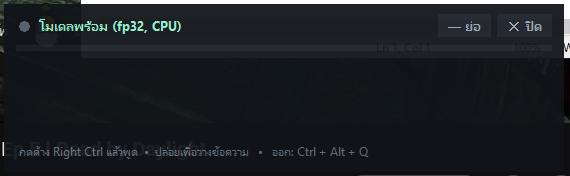
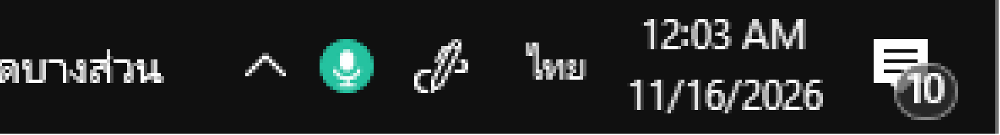

# ThaiASR — พูดแล้วออกมาเป็นข้อความ (OpenThai2.0-ASR-Streaming)

โปรแกรม dictation ภาษาไทยสำหรับ Windows: **กดค้าง `Right Ctrl` แล้วพูด ปล่อยปุ่ม ข้อความจะถูกวางลงในช่องที่เคอร์เซอร์อยู่**
(หรือจะใช้โหมด **กดครั้งเดียว** ก็ได้ — ดูหัวข้อ “โหมดปุ่มลัด”)
ใช้โมเดล [`iapp/OpenThai2.0-ASR-Streaming`](https://huggingface.co/iapp/OpenThai2.0-ASR-Streaming)
ผ่านไฟล์ ONNX [`iapp/OpenThai2.0-ASR-Streaming-ONNX`](https://huggingface.co/iapp/OpenThai2.0-ASR-Streaming-ONNX)
รันด้วย ONNX Runtime — **ไม่ต้องมี PyTorch และไม่ต้องมี NeMo** จึงติดตั้งเล็กและเปิดโปรแกรมได้เร็ว



## คุณสมบัติ

| | |
|---|---|
| ปุ่มลัด | กดค้างเพื่อพูด (`ctrl_r` โดยปริยาย) **หรือโหมดกดครั้งเดียว** + `Esc` ยกเลิก + `Ctrl+Alt+H` ย่อ/เปิด overlay + `Ctrl+Alt+Q` ออก |
| ปุ่มบนหน้าต่าง | `— ย่อ` ซ่อน overlay ไว้ทำงานต่อเบื้องหลัง (เปิดกลับด้วย `Ctrl+Alt+H` หรือเมนู tray) และ `✕ ปิด` ออกจากโปรแกรม |
| Tray icon | ไอคอนมุมขวาล่าง คลิกขวาได้: เริ่ม/หยุดพูด, ซ่อน-แสดง overlay, สลับ hold/toggle, ดาวน์โหลดโมเดล, เปิดโฟลเดอร์ log, เปิด `config.toml`, ออก — ไอคอนเปลี่ยนเป็น**สีแดงขณะอัดเสียง** |
| เปิดซ้อนไม่ได้ | เปิดโปรแกรมซ้ำจะขึ้นข้อความ “เปิดอยู่แล้ว” แล้วปิดตัวเอง (กันกด `run.bat` ซ้ำจนมีหลายตัว) |
| ข้อความไปที่ | วาง (Ctrl+V) ลงแอปที่โฟกัส + คัดลอกลงคลิปบอร์ด (คืนค่าเดิมของคลิปบอร์ดให้ด้วย) |
| หน้าต่าง | overlay เล็ก ๆ มุมล่างจอ แสดงข้อความสด ๆ ขณะพูด — ตั้งค่า `WS_EX_NOACTIVATE` จึง**ไม่แย่ง focus** |
| ประมวลผล | ONNX Runtime บน CPU (มี `--device cuda` ถ้าติดตั้ง `onnxruntime-gpu`) |
| ไฟล์ยาว | ตัดที่ช่วงหยุดพูดแล้วถอดทีละท่อนโดยอัตโนมัติ (`split_over_s`, ปริยาย 12 วิ) เพราะโมเดลนี้จะตกคำหลังช่วงเงียบถ้าป้อนยาวรวดเดียว |
| ใช้งานเดี่ยว | แพ็กเป็น `.exe` ได้ (`build_exe.bat`) พร้อมปุ่มสร้าง shortcut Start Menu/Desktop (`install_shortcut.bat`) |
| นอกเหนือจากนี้ | ประวัติ JSONL, ปรับได้ทั้งหมดผ่าน `config.toml`, โหมดไม่มีหน้าต่าง (`--no-ui`), แปลงไฟล์ (`--transcribe`) |


## ติดตั้ง

ต้องมี Python 3.12 (มี `uv` จะดีมาก) แล้วรัน

```bat
install.bat
```

ซึ่งจะสร้าง `.venv`, ติดตั้ง dependency (`onnxruntime`, `numpy`, `sounddevice`, `pynput`, `pyperclip`, `huggingface_hub`)
และดาวน์โหลดโมเดล fp32 (~2.6 GB, ครั้งเดียว) จากนั้นเริ่มใช้งานด้วย

```bat
run.bat
```

หรือใช้คำสั่งตรง ๆ:

```bat
uv venv .venv --python 3.12
uv pip install --python .venv\Scripts\python.exe -r requirements.txt
set PYTHONPATH=%CD%\src
.venv\Scripts\python.exe -m thaiasr --download
.venv\Scripts\python.exe -m thaiasr
```

## ใช้งาน

1. ดับเบิลคลิก `run.bat` (หรือ `python -m thaiasr`), จะมี overlay ขึ้นมุมล่างจอ **และไอคอน ThaiASR ที่มุมขวาล่าง (system tray)**
2. รอข้อความ “โมเดลพร้อม” (โหลดล่วงหน้า ~3–5 วินาที; ถ้าปิด `preload` จะโหลดตอนพูดครั้งแรกแทน)
3. **กดค้าง `Right Ctrl` แล้วพูดภาษาไทย** — ข้อความบางส่วนจะขึ้นบน overlay ระหว่างพูด
4. **ปล่อย `Right Ctrl`** — ข้อความสุดท้ายจะถูกวางลงในช่องที่เคอร์เซอร์อยู่ทันที (~0.3–1.5 วินาที ต่อคำพูด 3–8 วินาที)
5. `Ctrl+Alt+Q` เพื่อออก (หรือกดปุ่ม `✕ ปิด` ที่ overlay หรือเลือก “ออก” จากเมนู tray)

### ย่อหน้าจอ (ซ่อน overlay)

กดปุ่ม **`— ย่อ`** ที่มุมขวาบนของ overlay → หน้าต่างจะหายไป แต่โปรแกรมยังทำงานอยู่ (กดปุ่มพูดแล้วข้อความยังถูกวางให้ตามปกติ)
เปิดกลับได้ 3 ทาง: กด **`Ctrl+Alt+H`** · เมนู tray → **แสดง overlay** · หรือตั้ง `start_minimized = true` / `run.bat --minimized` ถ้าอยากเปิดมาแบบย่อไว้เลย

### โหมดปุ่มลัด (hold / toggle)

| โหมด | วิธีใช้ | เหมาะกับ |
|---|---|---|
| `hold` (ปริยาย) | **กดค้าง** `Right Ctrl` ขณะพูด ปล่อยเมื่อพูดจบ | พูดสั้น ๆ เป็นประโยค |
| `toggle` | **กดครั้งเดียว** เริ่มอัด, กดอีกครั้งเพื่อหยุดและวางข้อความ | พูดยาว ๆ ไม่ต้องเมื่อยนิ้ว |

สลับได้ 2 ทาง: คลิกขวาที่ไอคอน tray → **โหมดปุ่มลัด → กดครั้งเดียว (toggle)** (จำค่าไว้ใน `config.toml` ให้ด้วย)
หรือสั่งตอนเปิดโปรแกรม `run.bat --toggle` / ตั้ง `hotkey_mode = "toggle"` ใน `config.toml`

### Tray icon (มุมขวาล่าง)



คลิกขวาที่ไอคอน ThaiASR:

| เมนู | ทำอะไร |
|---|---|
| เริ่มพูด / หยุดพูด | เริ่ม-หยุดอัดเสียงโดยไม่ต้องใช้ปุ่มลัด (คลิกซ้ายที่ไอคอนก็ได้) |
| ซ่อน overlay / แสดง overlay | ย่อหน้าต่างไว้ให้เหลือแต่ไอคอน tray (เหมือนปุ่ม `— ย่อ`) |
| โหมดปุ่มลัด | สลับ hold ↔ toggle (บันทึกลง `config.toml`) |
| ดาวน์โหลดโมเดล | ดาวน์โหลดโมเดลเมื่อยังไม่มี (มีแถบความคืบหน้าบน overlay) |
| เปิดโฟลเดอร์ log / เปิด config.toml | เปิด `logs` และไฟล์ตั้งค่าใน Notepad |
| ออก (Ctrl+Alt+Q) | ปิดโปรแกรม |

> ถ้าไม่เห็นไอคอน ให้กดลูกศร `^` ที่มุมขวาล่าง (Windows ซ่อนไอคอนใหม่ไว้ในกล่องนั้น) แล้วลากไอคอน ThaiASR ออกมาไว้บนแถบได้เลย


### ปิดโปรแกรม

ปิดได้ 3 ทาง ใช้ทางไหนก็ได้:

1. กดปุ่ม **`✕ ปิด`** ที่มุมขวาบนของ overlay
2. กด **`Ctrl+Alt+Q`** (ใช้ได้แม้ overlay ไม่ได้โฟกัส และใช้ได้กับคีย์บอร์ด layout ไทย)
3. ถ้าโปรแกรมค้างจริง ๆ ดับเบิลคลิก **`stop.bat`** — จะปิดเฉพาะโปรเซสของ ThaiASR (ไม่กระทบ Python ตัวอื่น)
   หรือเปิด Task Manager แล้ว End task ที่ `pythonw.exe` ที่มีคำสั่ง `-m thaiasr`

### ตัวเลือกบรรทัดคำสั่งที่ใช้บ่อย

```bat
python -m thaiasr --download                  :: ดาวน์โหลดโมเดลอย่างเดียว
python -m thaiasr --transcribe a.wav          :: ถอดไฟล์ (ตัดที่ช่วงหยุดพูดอัตโนมัติถ้ายาวเกิน 30 วิ)
python -m thaiasr --selftest                  :: ตรวจว่าทุกอย่างทำงานจริงกับไฟล์ตัวอย่าง
python -m thaiasr --doctor                    :: ตรวจ import/โมเดล/ไมค์/การวาง (ใช้ตอนมีปัญหา)
python -m thaiasr --lang th-mix               :: คำอังกฤษออกเป็นตัวอักษรละติน
python -m thaiasr --hotkey f9                 :: เปลี่ยนปุ่มพูด
python -m thaiasr --toggle                    :: โหมดกดครั้งเดียวเริ่ม/หยุด (--hold = กดค้าง)
python -m thaiasr --minimized                 :: เปิดมาแบบย่อ overlay (เหลือแต่ tray)
python -m thaiasr --no-tray                   :: ไม่ต้องมีไอคอน tray
python -m thaiasr --allow-multiple            :: ยอมให้เปิดซ้อนได้ (ปริยายคือกันไว้)
python -m thaiasr --output clipboard          :: คัดลอกอย่างเดียว ไม่พิมพ์อัตโนมัติ
python -m thaiasr --precision int8            :: ใช้โมเดล int8 (~1 GB, เร็วกว่า)
python -m thaiasr --no-ui                     :: ไม่มีหน้าต่าง (สำหรับดีบัก/สคริปต์)
```

## ตั้งค่า

คัดลอก `config.example.toml` เป็น `config.toml` แล้วแก้ได้ตามต้องการ (ค่าที่ไม่ระบุจะใช้ค่าเริ่มต้น)
ค่าที่มักปรับ: `hotkey`, `hotkey_mode`, `lang`, `output`, `partials`, `precision`, `device`, `tray`, `overlay.*`
ตำแหน่งไฟล์/ประวัติคิดจากโฟลเดอร์ของ `config.toml`

### ตำแหน่งไฟล์ข้อมูล

| โหมด | `config.toml`, `models/`, `logs/`, `history.jsonl` อยู่ที่ |
|---|---|
| รันจาก source (`run.bat`) | โฟลเดอร์โปรเจกต์ `F:\ASR_Streaming` |
| รันจาก `.exe` | `%LOCALAPPDATA%\ThaiASR` (โฟลเดอร์ติดตั้ง `.exe` อาจถูกเขียนทับได้ จึงไม่เก็บข้อมูลไว้ที่นั่น) |

กำหนดเองได้ด้วยตัวแปรสภาพแวดล้อม `THAIASR_HOME`
และถ้ามีโมเดลอยู่แล้วข้าง ๆ `.exe` (เช่นตอนรันจาก `dist\ThaiASR\` ในโฟลเดอร์โปรเจกต์) โปรแกรมจะ**ใช้โมเดลนั้นให้เอง ไม่ต้องโหลดซ้ำ**

## แพ็กเป็น .exe (ให้คนอื่นใช้โดยไม่ต้องมี Python)

```bat
build_exe.bat          :: สร้าง dist\ThaiASR\ThaiASR.exe + ThaiASR-cli.exe (ใช้เวลาไม่กี่นาที)
install_shortcut.bat   :: เพิ่ม shortcut ที่ Start Menu + Desktop
```

- `ThaiASR.exe` — เปิดแบบไม่มีหน้าต่าง console (ใช้ประจำวัน: tray + overlay)
- `ThaiASR-cli.exe` — มี console สำหรับ `--download`, `--transcribe`, `--selftest`
- **ไม่ได้ฝังโมเดลไว้ใน .exe** (โมเดล 2.6 GB) — ครั้งแรกที่เปิด โปรแกรมจะบอกว่ายังไม่มีโมเดล ให้คลิกขวาที่ไอคอน tray → **ดาวน์โหลดโมเดล** (มีแถบความคืบหน้าบน overlay) หรือรัน `ThaiASR-cli.exe --download`
- ลบ shortcut ได้ด้วย `install_shortcut.bat remove`

**หมายเหตุสำหรับคนที่ build เอง:** `.exe` ต้องใช้ Visual C++ Redistributable (2015–2022) ของ Windows
สคริปต์ build จะคัดลอกตัวล่าสุดจาก `C:\Windows\System32` มาให้เอง (สำคัญมาก: ถ้าปล่อยให้ PyInstaller
ไปหยิบ `MSVCP140.dll` จากโฟลเดอร์อื่นใน PATH เช่น JRE เก่า `onnxruntime` จะ crash ทันทีด้วย `0xC0000005`)


## ความเร็วที่วัดได้ (เครื่องนี้: RTX 2060 SUPER, 8 logical CPU)

| | fp32, CPU |
|---|---|
| โหลดโมเดล | ~3.5 วินาที |
| คลิป 3.06 วิ | encode 0.53 + decode 0.45 วิ (rtf 0.32) |
| คลิป 8.82 วิ | encode 1.40 + decode 1.30 วิ (rtf 0.31) |

คือเร็วกว่า realtime ประมาณ 3 เท่า → คำพูด 5 วินาทีใช้เวลาถอด ~1.5 วินาที
ข้อความระหว่างพูด (partials) จะถอยจังหวะเองอัตโนมัติถ้าเครื่องตามไม่ทัน และหยุดเมื่อพูดยาวเกิน `partial_max_utterance_s`
(วัดใหม่ได้ด้วย `python tools/bench.py`)

## ตรวจสอบความถูกต้อง

- `python -m unittest discover -s tests` — 91 unit/integration tests (ไม่ต้องใช้โมเดลสำหรับชุด unit) รวมเทสต์ของ tray, โหมด toggle, กันเปิดซ้อน, การบันทึกค่า `hotkey_mode` และการค้นหาโมเดลของ `.exe`
- `python -m thaiasr --selftest` — ถอดไฟล์ตัวอย่างทั้ง 4, ตรวจว่าได้ข้อความไทย, ผลซ้ำได้เดิม (deterministic) และการตัดที่ช่วงหยุดพูดได้ 2 ท่อนตรงกับถอดแยกชิ้น 100%
- `tools/check_mel_vs_librosa.py` — ตรวจค่า log-mel ที่เราคำนวณเองเทียบกับ librosa (ผลต่างสูงสุด ~3e-09 ที่ตัวกรอง mel, ~2e-06 ที่ค่า mel, จำนวนเฟรมตรงกัน) ยืนยันว่าไม่ต้องพึ่ง PyTorch ก็ได้ค่าตรงกับที่ NeMo ใช้
- `python tools/smoke_ui.py` — เปิด overlay 3 วินาทีเพื่อตรวจหน้าตา/ฟอนต์ไทย

## หมายเหตุทางเทคนิค

- **สัญญาณของ ONNX encoder** (อ่านจาก graph จริง): อินพุต `audio_signal` float32 `[1,128,T]`, `length` int64, `prompt_index` int64 (32 = `th-TH`, 63 = `th-mix`) → เอาต์พุต `encoded` `[1,T/8,1024]` **ไม่มี cache tensor** จึงเป็นกราฟแบบป้อนทั้ง utterance แล้วถอดทีเดียว ตรงกับคำแนะนำของผู้พัฒนาโมเดลว่าให้ตัดไฟล์ยาวที่ช่วงหยุดพูด
- **decoder_joint** เป็น RNN-T greedy ทีละสเต็ป (`encoder_outputs [1,1024,1]`, `targets`, states `[2,1,640]` → 14989 คะแนน) ต้อง**บวก bias ที่คะแนน blank เอง**: −1.0 (standard), −2.5 (คลิป < 2 วิ), −4.0 (ถ้าผลว่าง), −2.0 (conversation) และใช้ `max_symbols_per_step = 2`
- **log-mel** ทำเองด้วย numpy ตามค่าใน `model_config.yaml` ของโมเดล (16 kHz, Hann 25 ms/hop 10 ms, n_fft 512, 128 mel, pre-emph 0.97, power 2.0, log(x + 2⁻²⁴), Slaney norm, ไม่ normalize)
- **การตัดที่ช่วงหยุดพูด** จำเป็นจริง: ทดลองต่อคลิปตัวอย่าง 4 คลิปที่มีช่วงเงียบ 1 วิ 1 คัน ได้ไฟล์ 27.6 วิ — ถ้าป้อนรวดเดียวจะตกคำ (“เปลือก” หายไป) แต่เมื่อตัดที่ช่วงหยุดพูดได้ 4 ท่อน ข้อความครบทุกคำ (ทดสอบซ้ำได้ด้วย `--transcribe` ไฟล์ที่ต่อเอง)
- ไฟล์ zip ของ graph (149 MB) จะถูกลบหลังแตกไฟล์แล้ว; ถ้าต้องการเก็บไว้ให้เพิ่ม `--keep-zip`

## แก้ปัญหา

| อาการ | วิธีแก้ |
|---|---|
| **ข้อความไม่ขึ้นในช่องที่ต้องการ** | 1) ต้อง**คลิกให้เคอร์เซอร์อยู่ในช่องข้อความก่อน**พูด (Ctrl+V จะไปที่ช่องที่โฟกัสตอนนั้น) 2) ข้อความ**ยังอยู่ในคลิปบอร์ด** กด `Ctrl+V` เองได้เสมอ 3) ถ้าอยากให้ลองพิมพ์แทนการวาง: `python -m thaiasr --paste-test --output type` 4) แอปที่รันแบบ administrator จะไม่รับ input สังเคราะห์ → ใช้ `--output clipboard` แล้ววางเอง |
| อยากรู้ว่าวางไปที่หน้าต่างไหน | ทุกครั้งจะบันทึกไว้ใน `history.jsonl` เช่น `"output": "pasted [target: chrome.exe — (4) Instagram]"` |
| ขึ้น “ยังไม่มีโมเดล” | คลิกขวาที่ไอคอน tray → **ดาวน์โหลดโมเดล** หรือ `python -m thaiasr --download` (หรือเลือก `precision = "int8"` ให้เล็กลง) |
| กดปุ่มแล้วไม่มีอะไรเกิดขึ้น | ปุ่มถูกแอปอื่นยึดอยู่ → เปลี่ยน `hotkey` เป็น `f9` เป็นต้น |
| เปิดโปรแกรมแล้วขึ้น “เปิดอยู่แล้ว” | มีตัวเก่ารันอยู่ — ดูไอคอน tray หรือปิดตัวเก่าด้วย `stop.bat` (ถ้าตั้งใจเปิดซ้อนจริง ๆ ใช้ `--allow-multiple`) |
| ไม่เห็นไอคอน tray | กดลูกศร `^` ที่มุมขวาล่าง แล้วลากไอคอน ThaiASR ออกมาบนแถบ; ถ้ายังไม่มีให้ดูว่า `tray = false` อยู่หรือเปล่า และดู `logs/thaiasr.log` ว่ามีบรรทัด `tray disabled` ไหม (ต้องติดตั้ง `pystray` + `pillow`) |
| ปิดโปรแกรมไม่ได้ | กด `✕ ปิด` ที่ overlay, หรือ `Ctrl+Alt+Q`, หรือดับเบิลคลิก `stop.bat` (ปุ่มลัดเทียบจาก**ตำแหน่งปุ่มจริง** จึงใช้ได้กับคีย์บอร์ด layout ไทย) |
| อยากรู้ว่าเบื้องหลังเกิดอะไรขึ้น | ดูไฟล์ `logs/thaiasr.log` (บันทึกเวลาเริ่ม, ตอนกดออก, และ error ตอนเปิดโปรแกรม) |
| เปิดแล้วเงียบ/มี error แต่ไม่รู้สาเหตุ | รัน `python -m thaiasr --doctor` (หรือ `ThaiASR-cli.exe --doctor` สำหรับ .exe) — ไล่เช็ค import, โมเดล, ไมค์, การวาง ให้ทีละขั้น |
| .exe เปิดไม่ขึ้นเลย | เปิด console ดูข้อความด้วย `ThaiASR-cli.exe --doctor` แล้วดู `%LOCALAPPDATA%\ThaiASR\logs\thaiasr.log` |
| อยากให้แม่นขึ้นกับเสียงพูดคุย | `mode = "conversation"` (bias −2.0) |
| คำอังกฤษออกเป็นไทย | ใช้ `lang = "th-mix"` |
| อยากได้คลิปบอร์ดเดิมคืนหลังวาง | ตั้ง `restore_clipboard = true` (ไม่แนะนำ เพราะถ้าการวางไม่ติด ข้อความจะหายจากคลิปบอร์ดด้วย) |
| กิน RAM/ดิสก์มาก | เปลี่ยนเป็น `precision = "int8"` (~1 GB) |

**ทดสอบครึ่งหลังของโปรแกรม (การวางข้อความ) แยกจากตัวโมเดล** — สะดวกมากเวลาแยกแยะว่า “ถอดเสียงไม่ดี” หรือ “วางไม่ติด”:

```bat
python -m thaiasr --paste-test
```
จะนับ 5 วินาทีให้คุณคลิกไปที่ช่องปลายทาง แล้ววางข้อความตัวอย่าง พร้อมบอกว่าหน้าต่างเป้าหมายคือหน้าต่างไหน (เช่น `chrome.exe — (4) Instagram`)

## ยังไม่รวมในเวอร์ชันนี้

ตัวเลือกแบบ GUI, การแยกผู้พูด (diarization), โหมด GPU อัตโนมัติ, พจนานุกรมคำเฉพาะ, คำสั่งเสียงวรรคตอน,
การลากไฟล์เสียงมาถอดผ่านหน้าต่าง, ออกซับ SRT
